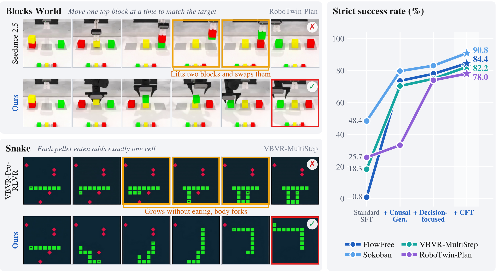

<div align="center">

<h1>ViDecide: Teaching Video Diffusion Models to Reason and Plan Step by Step</h1>

<a href="https://arxiv.org/abs/2611.26389"></a>
<a href="https://kevin-thu.github.io/ViDecide"></a>
<a href="https://huggingface.co/Kevin-thu/ViDecide"></a>
<a href="https://huggingface.co/datasets/Kevin-thu/ViDecide-Data"></a>

<a href="https://kevin-thu.github.io/homepage/">Kaiwen Zhang</a><sup>1</sup>, Yiming Gao<sup>2</sup>, <a href="https://xizaoqu.github.io/">Zeqi Xiao</a><sup>1</sup>, <a href="https://xinntao.github.io/">Xintao Wang</a><sup>3</sup>, Pengfei Wan<sup>2</sup>, <a href="https://scholar.google.com/citations?user=PXO4ygEAAAAJ">Kun Gai</a><sup>2</sup>, <a href="https://xingangpan.github.io/">Xingang Pan</a><sup>1</sup>

<sup>1</sup>S-Lab, Nanyang Technological University &nbsp; <sup>2</sup>KlingAI Research &nbsp; <sup>3</sup>CUHK

</div>

<p align="center"></p>

## 💡 Overview

ViDecide is a decision-centric framework that trains video diffusion models to predict state transitions causally and
decide when to stop, with a decision-focused training schedule. Corrective Fine-tuning (CFT) further corrects failed
decisions by mapping their noise to the model's own successful continuations, achieving stable improvement without
policy-gradient optimization. Across abstract games, planning tasks, and a new benchmark of multi-step robot planning,
ViDecide achieves an average strict success rate of 83.8%, far above 23.3% for standard fine-tuning and 67.8% for the
strongest prior method, and generalizes to larger puzzles and unseen layouts.

This repository contains the training code (SFT and CFT on Wan2.2-TI2V-5B, DiT-B from scratch), inference with the
visual EOS frame, the strict rule verifiers of all benchmarks, and the scripts that build the benchmark data.

## 🚀 Getting Started

### Installation

We used Python 3.10 and PyTorch 2.6 with CUDA 12.6. Generating one video needs about 30 GB of GPU memory (about
72 GB at the evaluation batch of 8). Training shards the model over the GPUs of a run; with two GPUs, an SFT step
peaked at about 65 GB and a CFT step, which starts from a full training state, at about 80 GB per GPU.

```bash
git clone --single-branch --branch main git@github.com:Kevin-thu/ViDecide.git
cd ViDecide
conda env create -f environment.yml && conda activate videcide
pip install torch==2.6.0 torchvision==0.21.0 --index-url https://download.pytorch.org/whl/cu126
pip install -r requirements.txt
pip install flash-attn==2.7.4.post1 --no-build-isolation   # optional; the paper's videos were generated with it
pip install -e .
bash scripts/setup/setup_causal_forcing.sh                  # Causal-Forcing at a fixed commit + our files (see NOTICE)
```

The RoboTwin-Plan verifier (DINOv3 needs a newer `transformers`) runs in its own environment; `VERIFIER_PYTHON` points
the scripts to it:
```bash
conda create -n videcide-verifier python=3.11 && conda activate videcide-verifier
pip install torch==2.14.1 torchvision==0.29.1 --index-url https://download.pytorch.org/whl/cu126
pip install -r requirements-verifier.txt
export VERIFIER_PYTHON=$(which python)
```
Rendering new RoboTwin-Plan episodes needs RoboTwin 2.0 (`bash scripts/setup/setup_robotwin.sh`, then `ROBOTWIN_PYTHON`).

### Models and Data

```bash
# Wan2.2-TI2V-5B (text encoder, VAE and model config)
huggingface-cli download Wan-AI/Wan2.2-TI2V-5B --local-dir checkpoints/Wan2.2-TI2V-5B
huggingface-cli download Wan-AI/Wan2.2-TI2V-5B-Diffusers --include "vae/*" --local-dir checkpoints/Wan2.2-TI2V-5B-Diffusers
# ViDecide models and data, then unpack the data archives in place
huggingface-cli download Kevin-thu/ViDecide --local-dir checkpoints/videcide
huggingface-cli download Kevin-thu/ViDecide-Data --repo-type dataset --local-dir data
find data -name "*.tar" -exec tar -xf {} -C data \;
# RoboTwin-Plan verifier backbone (gated, DINOv3 License); post-training on RoboTwin-Plan also uses DINOv2
huggingface-cli download facebook/dinov3-vitl16-pretrain-lvd1689m --local-dir checkpoints/dinov3-vitl16
huggingface-cli download facebook/dinov2-base --local-dir checkpoints/dinov2-base
```

| Model | Benchmark | Generation |
|---|---|---|
| `flowfree_cft`, `sokoban_cft` | FlowFree, Sokoban (VideoRLVR) | frame-wise ($K{=}1$) |
| `vbvr_cft` | VBVR-MultiStep | frame-wise ($K{=}1$) |
| `robotwin_cft` | RoboTwin-Plan | chunk-wise ($K{=}8$) |
| `robotwin_verifier/` | RoboTwin-Plan | state reader and appearance classifier of the verifier |

The models are the final CFT models of the paper (Tab. 5), trained with the training shift $s{=}10$. The dataset has
one folder per benchmark; every set is a JSONL manifest whose paths are relative to `data/`:

```
data/
├── VideoRLVR/
│   ├── FlowFree/     train, val, test, hard_train, hard_test (FlowFree-Hard), ood_9x9      + videos/ sources/ traces/
│   ├── Sokoban/      train, val, test, hard_train, hard_test (Sokoban-Hard), ood_4_boxes, ood_5_boxes   + videos/ sources/
│   └── Maze/         train, val, test                                                       + videos/ sources/
├── VBVR-MultiStep/   train, val, test (the clean test set)                                 + videos/ sources/ verifier/
└── RoboTwin-Plan/    train, val, test, ood_blocks_world_2x2, ood_tower_of_hanoi_2x2, ood_longer_plans   + episodes/
```

On Hugging Face, the videos, sources and episodes come as tar archives next to the manifests, one per set of a VideoRLVR
game (e.g. `VideoRLVR/FlowFree/train.tar`) and one per task of VBVR-MultiStep and RoboTwin-Plan. Their members are
stored relative to `data/`, so the `find ... tar` command above unpacks them in place (7.6 GB; the archives can be
deleted afterwards).

`hard_train` holds the 5,000 harder training puzzles used for post-training. A manifest row gives `sample_id`, `task`,
`split`, `prompt`, `native_frames`, `native_video` and `source_path` (the puzzle, or the episode metadata of
RoboTwin-Plan with its simulator states in `state_path`). The scripts in `scripts/benchmarks` and `scripts/robotwin`
rebuild the data: `render_videos.py` renders the FlowFree, Sokoban and Maze videos from their sources,
`generate_{flowfree,sokoban}_hard.py` generate hard puzzles, `build_vbvr.py` converts VBVR-MultiStep, and
`render_episodes.py` and `build_manifest.py` render and gate RoboTwin-Plan episodes.

### Quick Start

Solve a test puzzle with a released CFT model; the video ends at the model's own EOS frame and the strict verifier
replays every transition:
```bash
bash run_example.sh                                                                      # Sokoban test: 3 boxes, 39 moves
python demo.py --model checkpoints/videcide/flowfree_cft --example flowfree_test_00005   # FlowFree test: 8x8, 5 colors
```
The video is written to `outputs/demo/`. `demo.py --verify VIDEO` runs only the verifier (CPU; with `--task` and
`--source` for any FlowFree, Sokoban or Maze puzzle), and `--task/--first-frame/--source` solves your own puzzle.

## 📊 Evaluation

```bash
python scripts/eval/eval_causal.py --run-dir checkpoints/videcide/sokoban_cft --task sokoban --set test \
    --output outputs/eval/sokoban_cft/test
```

| `--task` | `--set` |
|---|---|
| `flowfree` | `test`, `hard_test`, `ood_9x9` |
| `sokoban` | `test`, `hard_test`, `ood_4_boxes`, `ood_5_boxes` |
| `maze` | `test` |
| `vbvr` | `test` |
| `robotwin` | `test`, `ood_blocks_world_2x2`, `ood_tower_of_hanoi_2x2`, `ood_longer_plans` |

The defaults follow the paper: 5 sampling steps per segment, no classifier-free guidance, seed 20261025, and the EOS
frame must appear within 320 frames (20 s). FlowFree, Sokoban and Maze videos are judged during generation
(`results.json`); VBVR-MultiStep and RoboTwin-Plan videos are scored afterwards:
```bash
python scripts/eval/score_vbvr.py outputs/eval/vbvr_cft/test           # strict rules
python scripts/eval/score_vbvr.py optimal outputs/eval/vbvr_cft/test   # + shortest solution (the paper's metric)
$VERIFIER_PYTHON scripts/robotwin/verifier.py --eval-dir outputs/eval/robotwin_cft/test --out outputs/eval/robotwin_cft/test/verifier
```
`--shard i --shards n --output DIR/shard<i>` splits a set over GPUs; the scorers read all shards of `DIR`. The
evaluation manifests store the per-video seed offset of the paper's evaluation, so the paper's sampling noise is
reproduced; the paper evaluated FlowFree and Sokoban with `--shards 3` and VBVR-MultiStep with `--shards 6` at the
default `--batch 8`, and RoboTwin-Plan with `--batch 4`, reporting the mean over `--seed 20261025`, `21261028` and
`22261031`. With these settings and FlashAttention installed, the models generate the paper's videos exactly.
Bidirectional (fixed-length) models are evaluated with `scripts/eval/eval_bidirectional.py`; the paper ran it with
`--batch 4` (VBVR-MultiStep: the default `--batch 8` and `--shards 2`), on RoboTwin-Plan with
`--durations-json data/latents/robotwin/lengths.json`.

## 🔧 Training

### Supervised fine-tuning

Training reads Wan2.2 VAE latents of the training videos, built once per benchmark (one GPU per `encode` shard):
```bash
python scripts/benchmarks/build_latents.py lengths --task sokoban
python scripts/benchmarks/build_latents.py encode --task sokoban --variants native,fixed_length --shard 0 --shards 1
python scripts/benchmarks/build_latents.py merge --task sokoban --variant native          # data/latents/sokoban/native
python scripts/benchmarks/build_latents.py merge --task sokoban --variant fixed_length    # bidirectional baseline
```
For a quick test, `encode --limit N` encodes only the N shortest videos of the shard; train on them with
`expected_train_rows=<their training rows>`. `scripts/train.sh` launches `torchrun` with a config; the GPUs times
`batch_size` must equal `total_batch_size`:
```bash
bash scripts/train.sh sft configs/sft/sokoban_k1.yaml 0,1 outputs/sft/sokoban_k1
bash scripts/train.sh sft configs/sft/sokoban_k1_stage2.yaml 0,1 outputs/sft/sokoban_k1_stage2 \
    resume_from=outputs/sft/sokoban_k1/checkpoint_model_023750/model.pt
bash scripts/train.sh sft configs/sft/vbvr_k1.yaml 0,1 outputs/sft/vbvr_k1
bash scripts/train.sh sft configs/sft/robotwin_k8.yaml 0,1,2 outputs/sft/robotwin_k8
```
FlowFree and Sokoban train in two stages of five epochs, Maze in one. Every benchmark has configs for frame-wise
(`k1`), chunk-wise (`k8`) and bidirectional fixed-length (`bidir`) generation. The training shift of Tab. 4 is
`model_kwargs.timestep_shift=1` or `=5`, and diffusion forcing (Tab. S7) is `teacher_forcing=false` on a `k1` config
(evaluated with `--context-sigma 0.1`). `scripts/export_model.py` exports a checkpoint as a model folder.

### Corrective Fine-tuning

CFT starts from the full training state of an SFT model and learns from corrections collected with it:
1. **Collect.** `scripts/posttrain/collect_<benchmark>.py` rolls out the SFT model on the training puzzles, locates the
   first error of every failed rollout with the verifier, and resamples four continuations from the chosen fork point.
   The training manifests store the seed offsets of the paper's collection (`seed_offset`, `continuation_seed_offsets`).
2. **Prepare.** `scripts/posttrain/prepare_<benchmark>_cft.py` gates the continuations, finds the divergence step,
   rebuilds the noise of the failed rollout there, and writes one training manifest per method: `metadata_cft.json`,
   `metadata_decision_rft.json`, `metadata_sample_rft.json` and `metadata_sft.json` (continued SFT).
3. **Train** with the config of the benchmark.

For Sokoban (collection and preparation on one GPU; `--shard i --shards n` splits the collection over GPUs; the
collectors roll out 12 videos at a time, which peaked at about 73 GB on FlowFree and 95 GB on VBVR-MultiStep, so use a
smaller `--batch` on smaller GPUs):
```bash
python scripts/posttrain/collect_sokoban.py --run-dir outputs/sft/sokoban_k1_stage2 --out outputs/cft_collect/sokoban
python scripts/posttrain/prepare_sokoban_cft.py all --collect outputs/cft_collect/sokoban --out outputs/cft_data/sokoban
bash scripts/train.sh posttrain configs/cft/sokoban.yaml 0,1,2 outputs/cft/sokoban \
    metadata_path=outputs/cft_data/sokoban/metadata_cft.json \
    sft_checkpoint=outputs/sft/sokoban_k1_stage2/checkpoint_model_047500/model.pt
```

<details>
<summary>FlowFree, VBVR-MultiStep and RoboTwin-Plan</summary>

```bash
# FlowFree: expert latents of the harder puzzles (build_latents.py lengths, encode and merge with --set hard_train),
# one collection on the training puzzles and one on the harder puzzles, then the manifests
python scripts/posttrain/collect_flowfree.py --run-dir outputs/sft/flowfree_k1_stage2 --shard 0 --shards 1 \
    --out outputs/cft_collect/flowfree --media outputs/cft_collect/flowfree_media
python scripts/posttrain/collect_flowfree.py --run-dir outputs/sft/flowfree_k1_stage2 --shard 0 --shards 1 \
    --manifest data/VideoRLVR/FlowFree/hard_train.jsonl \
    --out outputs/cft_collect/flowfree_hard --media outputs/cft_collect/flowfree_hard_media
python scripts/posttrain/prepare_flowfree_cft.py --sft-run outputs/sft/flowfree_k1_stage2 \
    --out outputs/cft_data/flowfree --collection outputs/cft_collect/flowfree:outputs/cft_collect/flowfree_media \
    --collection outputs/cft_collect/flowfree_hard:outputs/cft_collect/flowfree_hard_media

# VBVR-MultiStep: rollouts, fork points (strict rules and shortest solution), continuations, manifests, noise
python scripts/posttrain/collect_vbvr.py --run-dir outputs/sft/vbvr_k1 --stage roots \
    --out outputs/cft_collect/vbvr_roots
python scripts/posttrain/prepare_vbvr_cft.py forks --src outputs/cft_collect/vbvr_roots --out outputs/cft_collect/vbvr
python scripts/posttrain/collect_vbvr.py --run-dir outputs/sft/vbvr_k1 --stage branches --out outputs/cft_collect/vbvr \
    --manifest outputs/cft_collect/vbvr/manifest.jsonl
python scripts/posttrain/prepare_vbvr_cft.py --collect outputs/cft_collect/vbvr --sft-run outputs/sft/vbvr_k1 \
    --out outputs/cft_data/vbvr
python scripts/posttrain/prepare_vbvr_cft.py noise outputs/cft_data/vbvr/positives.json

# RoboTwin-Plan: the collector scores the videos with $VERIFIER_PYTHON; the recheck runs in the verifier environment
python scripts/posttrain/collect_robotwin.py --run-dir outputs/sft/robotwin_k8 --out outputs/cft_collect/robotwin \
    --tasks blocksworld/row_2-4,blocksworld/triangle_2-6,hanoi/triangle_2-5,sort/nobuffer_4
CUDA_VISIBLE_DEVICES= $VERIFIER_PYTHON scripts/posttrain/prepare_robotwin_cft.py recheck \
    --collection outputs/cft_collect/robotwin --recheck-dir outputs/cft_data/robotwin_recheck
python scripts/posttrain/prepare_robotwin_cft.py build --collection outputs/cft_collect/robotwin \
    --recheck-dir outputs/cft_data/robotwin_recheck --sft-run outputs/sft/robotwin_k8 --out outputs/cft_data/robotwin
python scripts/posttrain/prepare_robotwin_cft.py noise outputs/cft_data/robotwin/positives.json
```
</details>

The baselines of Tab. 5 use the same config with `rft_mode=decision_rft`, `sample_rft` or `sft` and their manifest.
The configs hold the paper's schedules. For a new collection, set `expected_train_rows` to the number of training rows
of the manifest (in `PREPARED.json`, for FlowFree `prepared_protocol.json`), and `max_iters` and
`resume_lr_schedule_steps` to the SFT steps plus the updates and to the updates (two epochs at batch 3 are the number
of training rows divided by 3).

### DiT-B

DiT-B (132M parameters, pixel space) is trained from scratch on FlowFree and Sokoban:
```bash
python scripts/dit/build_cache.py --task sokoban                     # data/dit/sokoban
torchrun --standalone --nproc_per_node=1 scripts/dit/train.py train --config configs/dit/sokoban_k1.yaml --out outputs/dit/sokoban_k1/train
torchrun --standalone --nproc_per_node=1 scripts/dit/train.py anneal --config configs/dit/sokoban_k1.yaml \
    --out outputs/dit/sokoban_k1/anneal --resume outputs/dit/sokoban_k1/train/step_010000/full_state.pt
```
`--arm` selects `k1`, `k8`, `bidir` or `df`, and `--mu` is $\log s$. CFT collects corrections with
`scripts/dit/rft_rollout.py` and `rft_branch.py` and trains with `scripts/dit/train_rft.py` and `configs/dit/cft_*.yaml`.

## 📌 Citation

If any part of our paper or code is helpful to your research, please consider citing our work 📝 and give us a star ⭐. Thanks for your support!

```bibtex
@article{zhang2026videcide,
  title   = {ViDecide: Teaching Video Diffusion Models to Reason and Plan Step by Step},
  author  = {Zhang, Kaiwen and Gao, Yiming and Xiao, Zeqi and Wang, Xintao and Wan, Pengfei and Gai, Kun and Pan, Xingang},
  journal = {arXiv preprint arXiv:2611.26389},
  year    = {2026}
}
```

## 📜 License

The code is released under the [S-Lab License 1.0](LICENSE.md) for non-commercial use; for commercial use, please
consult Prof. Xingang Pan (xingang.pan@ntu.edu.sg). Files derived from Causal-Forcing and Wan keep the Apache License 2.0,
and files derived from RoboTwin keep the MIT License; see [NOTICE](NOTICE). The data and models are released under
[CC BY-NC 4.0](https://creativecommons.org/licenses/by-nc/4.0/) for non-commercial use, as they build on
VideoRLVR-Data (CC BY-NC 4.0); they also build on VBVR-MultiStep (CC BY 4.0), RoboTwin 2.0 (MIT) and
Wan2.2-TI2V-5B (Apache 2.0).

## ❤️ Acknowledgement

This code builds on [Causal-Forcing](https://github.com/thu-ml/Causal-Forcing) and
[Wan2.2](https://github.com/Wan-Video/Wan2.2). The benchmarks use puzzles from
[VideoRLVR](https://github.com/luka-group/VideoRLVR) and the planning tasks of
[VBVR](https://huggingface.co/datasets/Video-Reason/VBVR-MultiStep), and RoboTwin-Plan is built in
[RoboTwin 2.0](https://github.com/RoboTwin-Platform/RoboTwin). RoboTwin-Plan also uses
[DINOv3](https://github.com/facebookresearch/dinov3) and [DINOv2](https://github.com/facebookresearch/dinov2)
features. We thank the authors for releasing their code, models and data.
